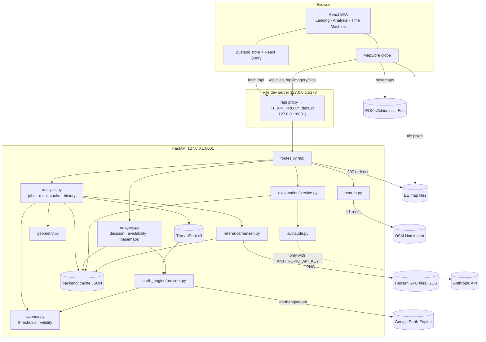
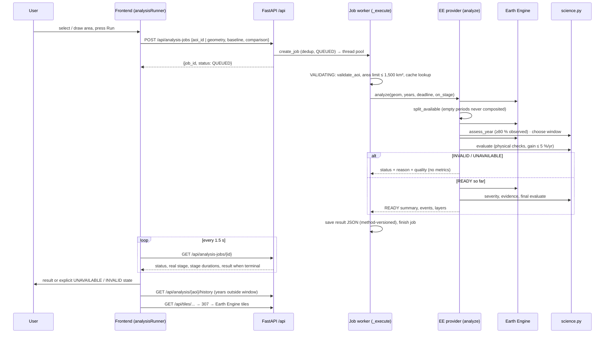

# TERRATRACE — Architecture and Pipeline

Reconstructed from the code on 2026-10-01 (method `tt-ee-2.1`). Status evidence: `TERRATRACE_PROJECT_AUDIT.md`.

## 1. System overview

| Layer | Technology | Location |
|---|---|---|
| UI | React 19, TypeScript 5.9, Tailwind 4, framer-motion | `frontend/src` |
| Map | MapLibre GL 5 (globe, raster tiles, AOI drawing) | `frontend/src/features/map` |
| Charts | ECharts 5 | `frontend/src/components/charts` |
| Client state | Zustand (UI + investigation), TanStack Query (server data) | `frontend/src/state`, `frontend/src/data` |
| Routing | hash routes (`#/`, `#/explore`, `#/analysis/<aoi>`, `#/timemachine/<aoi>`) | `frontend/src/lib/urlState.ts` |
| Dev server | Vite 7 on `127.0.0.1:5173`, proxies `/api` → `127.0.0.1:8001` | `frontend/vite.config.ts` |
| API | FastAPI on uvicorn `127.0.0.1:8001`, 20 routes under `/api` | `backend/app/api/routes.py` |
| Services | analysis (jobs, cache), imagery, search, geometry, explanation, science rules | `backend/app/services` |
| Providers | Earth Engine, Hansen tile sampler, Claude, featured registry | `backend/app/providers` |
| Computation | Google Earth Engine (project `terratrace-509821`, user OAuth credentials) | remote |
| Storage | JSON/PNG files in `backend/.cache` (no database) | local disk |
| Jobs | in-process `ThreadPoolExecutor(3)`, polled over HTTP | `services/analysis.py` |
| Logging | Python `logging` to stdout, `[EE] START/END` per Earth Engine request | backend |

Not present: database, authentication, Docker, CI/CD, external monitoring.

## 2. System diagram

## 3. Data flow — one analysis

## 4. Analysis pipeline (Earth Engine)

| Stage | Public stage name | What happens | EE requests |
|---|---|---|---|
| Validate | `VALIDATING` | GeoJSON, coordinates, 1,500 km² interactive limit, cached result | 0 |
| Metadata | `PREPARING_IMAGERY` | scene counts per year: Landsat (historical) or S2-with-Cloud-Score+ and Dynamic World (modern) | 1 |
| Composites | (lazy) | S2: Cloud Score+ `cs_cdf ≥ 0.6`, median; leaf-on NDVI = p90; DW `trees` mean, `label` mode. Landsat: QA_PIXEL mask, 3-year median | 0 |
| Coverage + statistics | `MEASURING_OBSERVATION_COVERAGE` | pixel observed if ≥ 3 clear obs (and ≥ 3 DW obs); year analysable if ≥ 80 % of AOI observed; forest areas, transitions, NDVI/NBR means in the same request | 1 |
| Extra transitions | `MEASURING_FOREST_COVER` | only pairs that skip an unusable year | 0–1 |
| Validation | (pre-events) | negative areas, forest % range, loss/gain ≤ compared area, cumulative loss, **gain ≤ 5 %/yr** | 0 |
| Change events | `DETECTING_CHANGE` | forest(b) ∧ ¬forest(c) ∧ [ΔNDVI ≤ −0.20 ∨ ΔNBR ≤ −0.25] ∧ Δtrees ≤ −0.30; MMU 2 ha; 60 largest polygons; persistence vs next year; Hansen overlap | 1 |
| Final validation | `VALIDATING_RESULT` | same rules with event KPIs | 0 |

Forest definition (modern): Dynamic World annual mean `trees` ≥ 0.50 **and** leaf-on NDVI ≥ 0.60, only on observed pixels.
Forest definition (historical): Landsat NDVI ≥ 0.60 (proxy). Eras are never subtracted from each other.

## 5. Status contract

| Status | Meaning | Metrics shown |
|---|---|---|
| READY | all checks passed | yes |
| INVALID_ANALYSIS | computed, failed a validity check (failing value included) | no |
| UNAVAILABLE | too large, no usable imagery, < 2 analysable years, EE not configured/unreachable | no |
| ERROR | timeout, throttling, unexpected failure (retryable) | no |
| CANCELLED | cancelled by the user | no |

## 6. Imagery path (independent of analysis)

`GET /api/imagery?aoi&year` → scene count → composite only if scenes > 0 → `getMapId` → `tileUrl=/api/imagery/tiles/...` → 307 to Earth Engine.
`GET /api/imagery/availability?aoi` → 17 composite years classified AVAILABLE / INSUFFICIENT / UNAVAILABLE with the analysis' own coverage rule.

## 7. Caching and state

| Cache | Key | Where | Bounded |
|---|---|---|---|
| Analysis results | `aid-b-c-tt-ee-2.1` | memory + `.cache/results` | no (purged on method change) |
| History | `aid-history-b-c-version` | memory + `.cache/results` | no |
| Imagery availability | `aid-lastyear-version` | memory + `.cache/imagery` | no |
| Imagery decisions | `(aid, year)` | memory | no |
| EE map ids | `(aid, kind, year)` | memory, 3 h TTL, expired pruned | yes |
| Jobs | job id | memory | 300 (oldest finished dropped) |
| Search | normalised query | memory | 500 |
| Registered AOIs | `aoi-<sha1[:12]>` | `.cache/aois` | no |
| Hansen tiles | `z_x_y` | `.cache/hansen` | no |
| Explanations | SHA-256 of facts | `.cache/explanations` | no |

## 8. Ports and configuration

| Item | Value |
|---|---|
| Frontend | `http://localhost:5173` (Vite, `host 127.0.0.1`, `strictPort`) |
| Backend | `http://127.0.0.1:8001` |
| Proxy target | `TT_API_PROXY` (default `http://127.0.0.1:8001`) |
| Required backend variable | `EE_PROJECT` (+ `earthengine authenticate` once) |
| Optional | `ANTHROPIC_API_KEY`, `EE_SERVICE_ACCOUNT_KEY`, `TT_*`, `EE_*` limits (see audit §18) |
