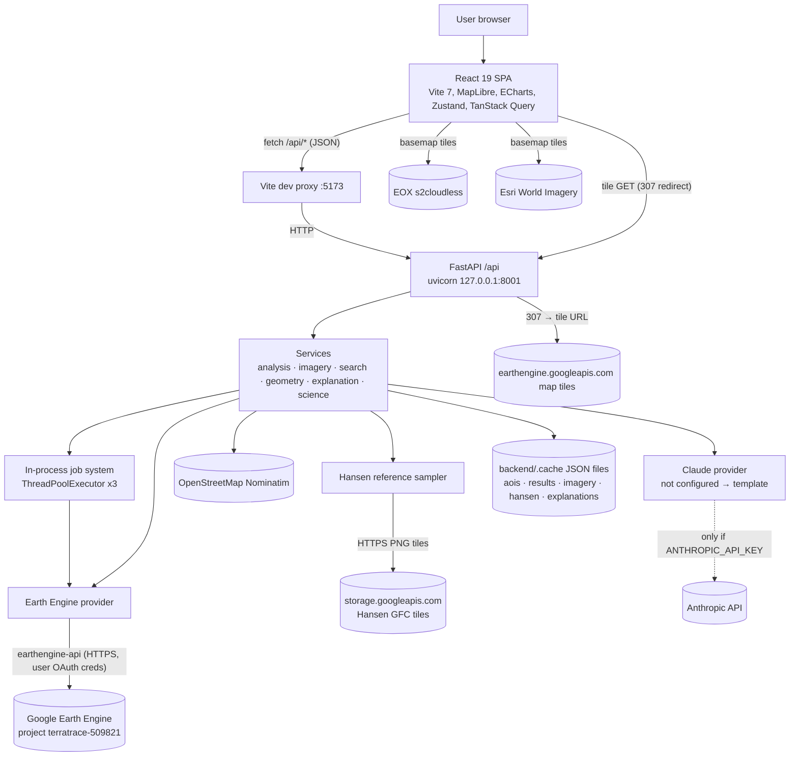

# TERRATRACE — Complete Project Audit

**Audit date:** 2026-10-01 · **Repository:** `C:\Users\HP\OneDrive\Documents\TERRATRACE 🌍` · **Git HEAD:** `2d049a4` (+ 42 uncommitted files)
**Method version under audit:** `tt-ee-2.1` (`backend/app/services/science.py`)
**Audit type:** read-only. No application code was changed. Side effects: the live checks below wrote
runtime cache files into `backend/.cache/` (3 registered AOIs, 2 analysis results), consumed a small
amount of Earth Engine compute, and the production build was written to a temporary folder (not `frontend/dist`).

### Status legend

| Symbol | Meaning |
|---|---|
| 🟢 | VERIFIED WORKING — demonstrated in this audit (test, execution, HTTP response, live Earth Engine run) |
| 🟡 | IMPLEMENTED BUT NOT VERIFIED — code complete, could not be executed here |
| 🟠 | PARTIALLY WORKING — part works, a required part fails or is blocked |
| 🔴 | BROKEN — reproduced failure |
| ⚪ | NOT IMPLEMENTED |
| 🔵 | CONFIGURED BUT UNUSED — present but not on the active path |
| 🟣 | SIMULATED / DEMO / PLACEHOLDER |

### Evidence log (commands run during this audit)

| ID | What was run | Result |
|---|---|---|
| E1 | `backend\.venv\Scripts\python -m pytest -q -rs` | **166 passed, 2 skipped** (skips = live-EE tests needing `TT_EE_LIVE=1`) |
| E2 | `TT_EE_LIVE=1 pytest -k "masked_pixel_is_not_non_forest or forest_area_sums_observed_pixels_only"` | **2 passed** (against real Earth Engine) |
| E3 | `npx tsc --noEmit -p .` (frontend) | passed, 0 errors |
| E4 | `npx vite build --outDir <temp>` | built in 20 s; bundles: maplibre 1,053 kB, index 640 kB, echarts 526 kB (gzip 285/197/176 kB) |
| E5 | `npm run test:markers` | 4/4 PASS (marker error 0.0 px) |
| E6 | `npm run test:integrity` (Playwright + Edge, against running app) | 163 PASS lines, "All integrity checks passed" |
| E7 | `python -m app.ee_check` | 9/10 PASS; LT05 failed once with a transient EE error; 3 immediate re-checks of LT05 all OK, 20 LT05 scenes found 1994–96 |
| E8 | `ee.data.getAsset` on all 8 dataset IDs | all exist; Hansen `lossyear` contains value 25 (loss through 2025) |
| E9 | HTTP calls to `127.0.0.1:8001` (health, study-areas, basemaps, search, analysis-status ×4, imagery, availability, preview, explain, history, tiles) | see §5 / §22 |
| E10 | **Fresh live analysis job**, 31 km² Jaú interior (Amazon), 2018→2025 | **READY in 66.6 s**, all 6 real stages reported, window narrowed to 2019–2025 (2018 coverage 0 %) |
| E11 | **Fresh live analysis job**, 31 km² Rondônia frontier | **INVALID_ANALYSIS in 13 s** — `unstable_forest_mask` (2024→25 gain 10.8 %/yr) |
| E12 | Live job create → cancel after 1.5 s | CANCELLED, stays CANCELLED, nothing stored (`analysis-status` = NOT_RUN) |
| E13 | Tile colour test after backend restart: `/api/tiles/silent-valley/{forest,change}/2025/14/x/y` | **both return the identical green forest tile** (33,472 px of #16a36d) |
| E14 | Path traversal probe `GET /api/aoi/..%5C..%5C..%5Cfrontend%5Cpackage` | 404 (fixed this session; regression tests in `test_public_errors.py`) |
| E15 | Repository-wide search for mock/demo/fake/simulated/random/placeholder | no data-generating code found (§20) |

---

## PART 1 — Executive summary

| | |
|---|---|
| **Project** | TERRATRACE — satellite forest-change intelligence prototype (university end-term + Innovation Expo) |
| **Purpose** | Let a user select any forest area, view real satellite imagery for it, and run a live, validated forest-cover and forest-change analysis |
| **Problem** | Forest loss is hard to quantify for a specific area without GIS expertise; existing global products are not interactive per area/window |
| **Target users** | Expo visitors, students, non-specialist decision makers (stated in `providers/ai/claude.py` system prompt) |
| **Technical approach** | All science runs server-side in **Google Earth Engine**: Sentinel-2 SR + Cloud Score+ + **Dynamic World V1** (pretrained Google model) for 2016+; Landsat C2 L2 NDVI proxy for 1984–2015; rule-based change detection; strict observation-coverage and physical-validity gating; Hansen GFC as independent reference |
| **Architecture** | React 19 + Vite 7 + MapLibre SPA → FastAPI (Python 3.14) → Earth Engine Python API. No database; JSON files on disk as cache. Asynchronous in-process job system |
| **Maturity** | Working local prototype. Not deployed, no authentication, no CI, single-process |
| **Overall** | Core pipeline is real and verified end to end (E10). No simulated scientific data was found. Several scientific-validity limitations make many real areas end in INVALID_ANALYSIS or produce questionable "loss" totals |

**Major working components (verified):** backend API and health; Earth Engine initialisation; imagery decision + Earth Engine tiles; per-year imagery availability; asynchronous analysis jobs (create, poll, cancel, cache); full live analysis to READY; validity gating to INVALID_ANALYSIS; history endpoint; search (gazetteer + Nominatim); AOI preview (Hansen reference); deterministic briefing; frontend build, typecheck, browser integrity tests.

**Broken (reproduced):** analysis `change` raster tiles after a backend restart render the forest mask (E13). The UI does not request these tiles, so the defect is latent.

**Major risks:**
1. **Scientific:** 3 of 4 featured investigations cannot produce a READY result (2 exceed the 1,500 km² interactive limit; Hasdeo Arand fails the 5 % gain check). Only Silent Valley is READY.
2. **Scientific:** "Total loss" KPIs sum gross year-to-year transitions, so classification flicker is reported as loss (Silent Valley, a protected park: 4,530 ha "loss" vs +1,053 ha net) (§9).
3. **Scientific:** a real deforestation frontier (Rondônia, E11) is rejected by the gain-stability rule — the core use case often ends INVALID.
4. **Reproducibility:** 42 files uncommitted, including the job test suite (`tests/test_jobs.py`, 38 tests) and `tests/conftest.py`.
5. **Security for any deployment:** no authentication; every analysis request spends the owner's Earth Engine quota.

**Major remaining tasks:** commit the working tree; decide how featured areas fit the 1,500 km² limit; change the loss KPI to net/persistent change or disclose it; disclose the 60-event cap; fix or remove the `change` tile rebuild path; update stale docs (`docs/METHOD.md`, `docs/CURRENT_REPOSITORY_AUDIT.md`).

---

## PART 2 — Complete project architecture

### Layers (as implemented)

```
USER (browser)
 ↓ hash routes  #/  #/explore  #/analysis/<aoi>  #/timemachine/<aoi>
FRONTEND  React 19 · Zustand store · TanStack Query · MapLibre GL · ECharts   (frontend/src)
 ↓ fetch /api/*  (Vite dev proxy → 127.0.0.1:8001; same origin in single-port mode)
API       FastAPI router /api (backend/app/api/routes.py) · global error handlers (main.py)
 ↓
SERVICES  analysis.py (jobs, cache, envelopes) · imagery.py · search.py · geometry.py · explanation/service.py · science.py (rules)
 ↓
PROVIDERS earth_engine/provider.py · reference/hansen.py (tile sampling) · ai/claude.py · registry.py (featured AOIs)
 ↓
EARTH ENGINE (server-side computation)  S2 SR Harmonized · Cloud Score+ · Dynamic World V1 · Landsat C2 L2 · Hansen GFC v1.13
 ↓
PROCESSING  scene counts → composites → observation coverage → forest masks → transitions → change polygons
 ↓
VALIDATION  science.assess_year (coverage) · science.evaluate (physical validity, gain stability)
 ↓
RESULT  envelope {analysisStatus READY | UNAVAILABLE | INVALID_ANALYSIS | ERROR | CANCELLED}; cached as JSON
 ↓
MAP / UI / REPORT  EE tile redirects · event polygons · charts · briefing · printable event brief (window.print)
```

### Architecture diagram



### Connections

| Source → Destination | Protocol / method | Purpose |
|---|---|---|
| Browser → Vite dev server :5173 | HTTP | serve SPA, proxy `/api` |
| Vite → FastAPI :8001 | HTTP proxy (`vite.config.ts`, `TT_API_PROXY`) | all API calls |
| Frontend → `/api/analysis-jobs` | POST + GET poll (1.5 s) | asynchronous analysis |
| Frontend → `/api/imagery`, `/api/imagery/availability` | GET | imagery decision / timeline |
| Frontend → `/api/tiles/…`, `/api/imagery/tiles/…` | GET → 307 redirect | Earth Engine map tiles |
| Browser → `earthengine.googleapis.com/v1/projects/terratrace-509821/maps/<id>/tiles` | HTTPS GET (after redirect) | tile pixels |
| FastAPI → Earth Engine | `earthengine-api` (REST, OAuth user credentials) | all computation |
| FastAPI → `storage.googleapis.com/earthenginepartners-hansen/tiles/gfc_v1.4/tree_alpha` | HTTPS GET (httpx) | AOI preview tree-cover reference |
| FastAPI → `nominatim.openstreetmap.org/search` | HTTPS GET (httpx, ≤1 req/s) | place search |
| FastAPI → Anthropic Messages API | HTTPS (anthropic SDK) | optional briefing — **not active** (no key) |
| Browser → EOX / Esri tile servers | HTTPS | static basemaps, labels |
| FastAPI → `backend/.cache/*` | file I/O | result / availability / AOI / tile cache |

Not present: database, authentication, message queue, Redis, Docker, CI/CD, monitoring service. Logging = Python `logging` to stdout.

---

## PART 3 — Technology inventory

| Component | Technology | Version (installed) | Where used | Purpose | Status | Evidence |
|---|---|---|---|---|---|---|
| Backend language | Python | 3.14.7 | `backend/` | runtime | 🟢 | E1 |
| Web framework | FastAPI / Starlette | 0.141.1 / 1.7.0 | `app/main.py`, `api/routes.py` | REST API | 🟢 | E9 |
| ASGI server | uvicorn | 0.54.0 | startup | serve API | 🟢 | running on :8001 |
| Validation | pydantic | 2.13.5 | `schemas.py` | request/response models | 🟢 | E1 |
| Config | python-dotenv | 1.2.3 | `config.py` | load `backend/.env` | 🟢 | EE_PROJECT read |
| HTTP client | httpx | 0.28.1 | search, Hansen tiles | external HTTP | 🟢 | search + preview responses |
| Imaging | Pillow | 12.3.0 | `reference/hansen.py` | decode Hansen PNG tiles | 🟢 | preview 99.0 % |
| Earth observation | earthengine-api | 1.7.45 | `providers/earth_engine` | all science | 🟢 | E7, E10 |
| Google auth | google-auth | 2.58.1 | via earthengine-api | OAuth user credentials | 🟢 | E7 |
| LLM SDK | anthropic | 1.8.0 | `providers/ai/claude.py` | optional briefing | 🔵 | no key configured |
| Backend tests | pytest | 9.1.1 | `backend/tests` | unit/API tests | 🟢 | E1 |
| Frontend language | TypeScript | 5.9.3 | `frontend/src` | typed UI | 🟢 | E3 |
| JS runtime | Node.js | 24.21.0 | build/dev | tooling | 🟢 | E4 |
| UI framework | React / react-dom | 19.3.0 | SPA | UI | 🟢 | E6 |
| Build tool | Vite (+ @vitejs/plugin-react 5.2.0) | 7.3.6 | dev server, build | bundling | 🟢 | E4 |
| Styling | Tailwind CSS (@tailwindcss/vite) | 4.3.3 | `index.css` | styles | 🟢 | E4 |
| Map | MapLibre GL | 5.24.0 | `features/map` | globe, tiles, AOI drawing | 🟢 | E5, E6 |
| Charts | ECharts | 5.6.0 | `components/charts` | forest cover / loss / signal charts | 🟡 | built (E4); not exercised with READY data in tests |
| State | Zustand | 5.0.15 | `state/store.ts` | UI / investigation state | 🟢 | E6 |
| Server state | TanStack React Query | 5.104.0 | `data/queries.ts` | fetching/caching | 🟢 | E6 |
| Animation | framer-motion | 12.43.0 | 20 files | UI motion | 🟢 | E4 |
| Icons | lucide-react | 1.48.0 | 19 files | icons | 🟢 | E4 |
| Fonts | @fontsource (Inter, Space Grotesk, JetBrains Mono) | 5.3.x | `main.tsx` | typography | 🟢 | E4 |
| Browser testing | playwright-core (Edge channel) | 1.63.0 | `frontend/scripts/*.mjs` | integrity/marker checks | 🟢 | E5, E6 |

Not found anywhere: Supabase, PostgreSQL, SQLite, Redis, Plotly, NumPy, Pandas, rasterio, GDAL, shapely, geopandas, scikit-learn, PyTorch, TensorFlow, OpenAI, Gemini, Docker, GitHub Actions. (`.gitignore` contains `ml/` and model-file patterns, but **no `ml/` directory or model file exists**.)

---

## PART 4 — Frontend audit

**Location:** `frontend/` (only `package.json` in the repo). 7,959 lines of TS/TSX in `src/`.
**Framework:** React 19 SPA, Vite 7, hash routing implemented by hand in `lib/urlState.ts`
(`#/`, `#/explore`, `#/analysis/<aoi>?from&to&year`, `#/timemachine/<aoi>?…`). No router library.
**State:** one Zustand store (`state/store.ts`) holding `investigation` (study, AOI, years, analysisStatus, requestId, job); TanStack Query for server data.
**API client:** `data/client.ts` (`API = VITE_API_BASE ?? '/api'`), typed contracts in `data/contracts.ts`.
**Environment:** no frontend `.env` file; only `VITE_API_BASE` (optional, unset). Credentials never in frontend.

| Feature | Files | Backend dependency | Status | Evidence |
|---|---|---|---|---|
| Boot, shell, header, system notices | `app/App.tsx`, `features/shell/*` | `/api/health` (30 s refetch) | 🟢 | E6; header notices driven by health |
| Globe + basemaps + night shading | `features/map/TerraMap.ts`, `MapCanvas.tsx`, `lib/solar.ts` | `/api/imagery/basemaps` (offline copy `public/data/basemaps.json`) | 🟢 | E5, E6 |
| Featured investigations + markers | `features/explore/Landing.tsx` | `/api/study-areas` (offline copy `public/data/featured.json`), `/api/analysis-status/*` | 🟢 | E5 (markers 0.0 px), E9 |
| Search | `features/explore/SearchBar.tsx` | `/api/search` | 🟢 | E9 (Borneo, Manaus) |
| Draw AOI / selection panel | `features/map/AoiDrawer.ts`, `SelectionPanel.tsx` | `POST /api/aoi`, `POST /api/aoi/preview` | 🟡 | endpoints verified (E9); drawing interaction not driven by a test |
| Real imagery per year | `data/imagerySync.ts`, `features/map/eeTiles.ts` | `/api/imagery`, `/api/imagery/tiles/*` | 🟢 | E9 tile 200; E6 |
| Bounded EE tile loader (429 retry/park) | `features/map/eeTiles.ts` | EE tiles | 🟡 | code reviewed; throttling not reproduced |
| Run analysis / job polling / cancel | `data/analysisRunner.ts`, `AnalyzingOverlay.tsx` | `/api/analysis-jobs*` | 🟢 | E6 (1 request per Run), E10, E12 |
| Result overview / metrics | `Overview.tsx`, `MetricsStrip.tsx` | READY envelope | 🟡 | data verified via API (E10); UI rendering of READY not asserted by tests |
| Unavailable / invalid states | `Unavailable.tsx`, `design/States.tsx` | non-READY envelope | 🟢 | E6 ("no synthetic AnalysisResult") |
| Event list / inspector | `EventList.tsx`, `EventInspector.tsx` | `events` FeatureCollection | 🟡 | not exercised with READY data in tests |
| Layer panel (forest / change / imagery) | `LayerPanel.tsx`, `features/map/registry.ts` | `/api/tiles/*`; change drawn as vector polygons | 🟡 | forest tiles verified via HTTP (E13) |
| Time Machine (year slider, history) | `TimeMachine.tsx`, charts | `/api/analysis/{aid}/history`, `/api/imagery` | 🟡 | history endpoint verified (E9); UI playback not tested |
| Charts | `components/charts/*` | READY + history | 🟡 | build only |
| AI briefing | `Briefing.tsx`, `explain/facts.ts` | `POST /api/explain` | 🟢 (template) | E9 |
| Event brief / PDF | `ReportModal.tsx` | none (renders loaded event) | 🟡 | browser `window.print()`; not tested |
| URL state / deep links | `lib/urlState.ts` | `/api/aoi/{id}` for custom AOIs | 🟢 | E6 ("URL hydration executes 0 analysis requests") |
| Authentication | — | — | ⚪ | header literally says "Not signed in · prototype build" |
| Settings page | — | — | ⚪ | none |

**Dead / unused frontend code:** `frontend/archive/presentation/Presenter.tsx` (not imported, outside `src`). `client.studyAreas` name has no callers (`listStudyAreas` is used). Everything else under `src/` is reachable from `App.tsx`.

---

## PART 5 — Backend audit

| Module | Responsibility |
|---|---|
| `main.py` | app factory, CORS (only `localhost:5173` / `127.0.0.1:5173`), global error handlers (no raw exception text to browser), startup purge of stale caches, background EE warm-up, optional static mount of `frontend/dist` |
| `config.py` | `Settings` from env (`backend/.env`) |
| `errors.py` | public error contract `{code, user_message, retryable}`; `DEV_DIAGNOSTICS` |
| `schemas.py` | pydantic models |
| `api/routes.py` | 20 routes under `/api` |
| `services/analysis.py` | AOI registry (disk), job system (thread pool ×3), result cache (memory + disk, method-versioned), history, envelopes |
| `services/science.py` | all thresholds, coverage rule, validity evaluation, severity, evidence score, KPIs |
| `services/imagery.py` | imagery decision, availability (2 EE requests), basemap config |
| `services/geometry.py` | GeoJSON validation, spherical area, limits, fingerprint ids |
| `services/search.py` | coordinates → featured → gazetteer → Nominatim |
| `services/explanation/service.py` | template briefing; optional Claude with numeric fact-check |
| `providers/earth_engine/provider.py` | every Earth Engine call |
| `providers/reference/hansen.py` | Hansen tree-cover sampling from public PNG tiles |
| `providers/ai/claude.py` | Anthropic call |
| `providers/registry.py` | featured AOIs from `data/featured_investigations.json` |
| `ee_check.py` | read-only EE verification CLI |
| `scripts/dev/*` | developer EE profiling/diagnostics (not imported by the app) |

### Endpoints

| Method | Route | Purpose | Input | Output | Dependencies | Status |
|---|---|---|---|---|---|---|
| GET | `/api/health` | readiness | — | status, EE/explainer/geocoder state, limits | EE init + test request | 🟢 E9 |
| GET | `/api/study-areas` | featured AOIs | — | 4 areas (geometry, no metrics) | JSON file | 🟢 E9 |
| POST | `/api/aoi` | register AOI | GeoJSON, name | AOI doc, id `aoi-<sha1[:12]>` | disk | 🟢 E10 |
| GET | `/api/aoi/{aid}` | AOI doc | id | AOI doc | registry / disk (validated id) | 🟢 E1, E14 |
| POST | `/api/aoi/preview` | area + Hansen 2000 cover | GeoJSON | area, forest_cover_pct | Hansen tiles | 🟢 E9 (99.0 %) |
| POST | `/api/analysis-jobs` | create/join job | aoi_id or geometry, years | job | thread pool, EE | 🟢 E10, E11 |
| GET | `/api/analysis-jobs/{id}` | poll | job id | status, stage, stages, result | memory | 🟢 E10 |
| POST | `/api/analysis-jobs/{id}/cancel` | cancel | job id | job | memory | 🟢 E12 |
| GET | `/api/analysis-status/{aid}` | stored status (never computes) | id, years | READY / INVALID / UNAVAILABLE / NOT_RUN / RUNNING | cache | 🟢 E9 |
| GET | `/api/analysis/{aid}/history` | out-of-window years | id, years | years, periods, history | EE (cached) | 🟢 E9 |
| GET | `/api/analysis/{aid}` | legacy synchronous analysis (waits ≤120 s) | id, years | envelope | job system | 🔵 200, unused by frontend |
| POST | `/api/analyze` | legacy synchronous analysis | geometry + periods | envelope | job system | 🔵 unused by frontend (tests only) |
| GET | `/api/progress/{rid}` | legacy stage by request id | rid | stage | memory | 🔵 unused by frontend |
| POST | `/api/explain` | event briefing | facts | text, source | template / Claude | 🟢 template; Claude 🔵 |
| GET | `/api/search` | place search | q | results, notice | gazetteer, Nominatim | 🟢 E9 |
| GET | `/api/imagery` | imagery decision | aoi, year | READY+tileUrl / UNAVAILABLE+code | EE | 🟢 E9 (2025: 172 scenes; 1984: NO_LANDSAT_IMAGERY) |
| GET | `/api/imagery/availability` | per-year timeline | aoi | 17 years with status/coverage | EE (2 requests) | 🟢 E9 |
| GET | `/api/imagery/basemaps` | static basemaps | — | EOX, Esri, Hansen tiles config | none | 🟢 E9 |
| GET | `/api/imagery/tiles/{aid}/{year}/{z}/{x}/{y}` | imagery tile | — | 307 → EE tile | EE getMapId | 🟢 E13 |
| GET | `/api/tiles/{aid}/{kind}/{year}/{z}/{x}/{y}` | analysis layer tile (`imagery` / `forest` / `change`) | — | 307 → EE tile | EE getMapId | 🟢 imagery, forest · 🔴 `change` after restart (E13) |
| GET | `/docs`, `/openapi.json` | FastAPI auto docs | — | — | — | 🟢 200 |

**Job system:** see Part 15. **Caching:** memory dicts + JSON on disk, keyed by AOI, window and method version; stale versions purged at startup. **Error handling:** public error codes only; tracebacks stay in server log (`main.py` handlers; tested by `test_public_errors.py`). **Logging:** stdout via `logging`; `[EE] START/END` timing per Earth Engine request. **Health:** real (EE initialised **and** a test request answered).

---

## PART 6 — API inventory

| API / service | Purpose | Auth | Code location | Env variable | Actually called? | Active in pipeline? | Status | Evidence |
|---|---|---|---|---|---|---|---|---|
| TERRATRACE REST `/api/*` | internal API | none | `api/routes.py` | — | yes | yes | 🟢 | E9 |
| Google Earth Engine | all computation, tiles | OAuth user credentials (`earthengine authenticate`), project `EE_PROJECT` | `providers/earth_engine/provider.py` | `EE_PROJECT`, optional `EE_SERVICE_ACCOUNT_KEY` | yes | yes | 🟢 | E7, E10 |
| Earth Engine map tiles | imagery/forest raster tiles | capability URL (map id) | `routes.py` → 307 redirect | — | yes | yes | 🟢 | E13 |
| Hansen GFC public tiles (GCS) | AOI preview reference | none | `providers/reference/hansen.py` | — | yes | preview only | 🟢 | E9 |
| OpenStreetMap Nominatim | geocoding | none (User-Agent) | `services/search.py` | `TT_GEOCODER`, `TT_USER_AGENT` | yes | search only | 🟢 | E9 (Manaus) |
| EOX s2cloudless 2025 | globe basemap | none | `imagery.py` → frontend | — | yes (browser) | display only | 🟢 | E6 |
| Esri World Imagery / labels | hi-res basemap, labels | none | `imagery.py` → frontend | — | yes (browser) | display only | 🟢 | E6 |
| Anthropic (Claude) | optional briefing | API key | `providers/ai/claude.py` | `ANTHROPIC_API_KEY`, `TERRATRACE_LLM_MODEL`, `TERRATRACE_LLM_EFFORT` | **no** (no key) | no | 🔵 | `/api/health` explainer = unconfigured; E9 source=template |
| OpenAI, Gemini, Supabase, PostgreSQL, NASA APIs, Sentinel Hub, Google Maps | — | — | — | — | not found | — | ⚪ | E15 search |

Note: Sentinel-2, Landsat, Dynamic World and Hansen are **datasets read through Earth Engine**, not separate APIs.

---

## PART 7 — Earth observation audit

All IDs below are taken from `provider.py` and verified to exist in Earth Engine (E7, E8).

| Dataset | Provider | Collection ID | Time range used | Resolution | Bands used | Cloud masking | Preprocessing | Composite | Indices | Where used | Status |
|---|---|---|---|---|---|---|---|---|---|---|---|
| Sentinel-2 MSI L2A SR Harmonized | Copernicus/ESA via EE | `COPERNICUS/S2_SR_HARMONIZED` | calendar years 2016 → (today − 1); EE holds scenes from 2017-03-28 for most areas, a few 2016 scenes exist (6 over Rondônia, 6 over Silent Valley) | 10–20 m (stats at 30 m, events at 20 m) | B2, B3, B4, B8, B11, B12 → blue, green, red, nir, swir1, swir2 | Cloud Score+ `cs_cdf ≥ 0.60` per pixel; scenes without Cloud Score+ excluded | DN / 10000 | per-pixel **median** (annual); NDVI leaf-on = per-pixel **p90** of clear NDVI | NDVI (median), NBR (nir/swir2), leaf-on NDVI | modern composites, imagery tiles, events | 🟢 |
| Cloud Score+ | Google | `GOOGLE/CLOUD_SCORE_PLUS/V1/S2_HARMONIZED` | linked to each S2 scene | 10 m | `cs_cdf` | — (is the mask) | `linkCollection` | — | — | S2 masking | 🟢 |
| Dynamic World V1 | Google / WRI | `GOOGLE/DYNAMICWORLD/V1` | calendar years 2016+ | 10 m | `trees`, `label` | (inherits S2 scene availability) | — | annual **mean** of `trees`; **mode** of `label` | Δ tree probability | forest rule, change rule, event land cover | 🟢 |
| Landsat 5 TM C2 L2 | USGS via EE | `LANDSAT/LT05/C02/T1_L2` | historical windows | 30 m | SR_B1,2,3,4,5,7 | QA_PIXEL bits 1 (dilated cloud), 3 (cloud), 4 (shadow) | ×0.0000275 − 0.2 | 3-year **median** (merged L5/L7/L8/L9) | NDVI, NBR | historical era, imagery | 🟢 (E7 transient fail, re-verified) |
| Landsat 7 ETM+ C2 L2 | USGS | `LANDSAT/LE07/C02/T1_L2` | same | 30 m | SR_B1,2,3,4,5,7 | same | same | same | same | same | 🟢 |
| Landsat 8 OLI C2 L2 | USGS | `LANDSAT/LC08/C02/T1_L2` | same | 30 m | SR_B2–B7 | same | same | same | same | same | 🟢 |
| Landsat 9 OLI-2 C2 L2 | USGS | `LANDSAT/LC09/C02/T1_L2` | same (only windows up to 2016 are used) | 30 m | SR_B2–B7 | same | same | same | same | effectively unused (historical windows end 2016; L9 starts 2021) | 🔵 |
| Hansen Global Forest Change v1.13 | UMD / Google | `UMD/hansen/global_forest_change_2025_v1_13` | `lossyear` 2001–2025 (value 25 verified) | 30 m | `lossyear` | — | — | — | — | event `reference_overlap` | 🟢 |
| Hansen tree cover 2000 tiles | UMD (public PNG tiles, gfc_v1.4) | `storage.googleapis.com/earthenginepartners-hansen/tiles/gfc_v1.4/tree_alpha` | 2000 | ~z≤12 tiles | alpha = canopy % | — | 64×64 sample | — | — | AOI preview, reference overlay | 🟢 |
| Sentinel-2 cloudless 2025 (EOX) | EOX | tile URL | 2025 mosaic | — | RGB | — | — | — | — | globe basemap only | 🟢 |
| Esri World Imagery | Esri/Maxar | tile URL | undated | — | RGB | — | — | — | — | basemap only | 🟢 |

Not used: MODIS, Sentinel-1, DEM, VIIRS fire, PRODES/DETER, GEDI.

---

## PART 8 — Time range audit

Composite years (`imagery.candidate_years`, `provider.analyze`): **1984, 1990, 1995, 2000, 2005, 2010, 2015** (historical, 3-year Landsat windows: e.g. 1990 = 1989–1991, 1984 = 1984–1985, 2015 = 2014–2016) and **every year 2016 → 2025** (modern; `latest = today.year − 1`).

| Requested period | Available period | Actually used period | Missing period | Reason |
|---|---|---|---|---|
| Default window 2018 → 2025 | modern years with S2 + DW scenes | years passing ≥ 80 % coverage; window narrowed to first/last passing modern year | e.g. Jaú 2018 (0 % coverage) → used 2019–2025 (E10) | coverage rule; window shrink reported in `analysis_window.requested` |
| "1984 → today" (README / Time Machine) | 7 historical snapshots + annual 2016+ | historical years are **context only** (history endpoint, charts); never change the window result | single years 1986–1988, 1992–94, etc. are not composites; Silent Valley 1984 = 0 Landsat scenes (E9) | method design; Landsat archive gaps over India |
| Change events | modern era only | between the analysable baseline and comparison composite of the window | historical era never produces events | Dynamic World required (from mid-2015) |
| 2016 / 2017 | S2 SR is sparse: 2016 only a handful of scenes; 2017 from 28 March | counted AVAILABLE when ≥ 80 % of pixels have ≥ 3 clear obs (Silent Valley 2016: 6 scenes → AVAILABLE) | Jan–Mar 2017; most of 2016 | catalogue start; partial-year composites have seasonal bias (§9) |
| Window crossing eras (e.g. 2010 → 2025) | historical + modern | window built from modern years only; historical pair reported separately | — | eras never subtracted (by design) |
| Latest year | 2025 | 2025 | 2026 (current year) | only complete years are composited |

**Statement for reports:** TERRATRACE measures forest change for **annual composites from 2016/2017 onward (default 2018–2025)**. 1984–2015 is available as seven Landsat snapshot composites for imagery and historical context, with a coarser NDVI-only forest proxy; it is not a continuous 1984–2025 annual analysis.

---

## PART 9 — Scientific validity audit

### Correct and verified safeguards

| Check | Implementation | Evidence |
|---|---|---|
| Empty ImageCollections never composited | `split_available` before `_composite`; `imagery_layer` returns before compositing when scenes = 0 | `test_ee_empty_collections.py`; E9 1984 → NO_LANDSAT_IMAGERY |
| Zero-band images | prevented by the above | tests |
| `unmask(0)` only on observation **counts** | `clear`, `dw_obs` — counts are true zeros; forest/indices stay masked | code review `provider.py:387–399` |
| Missing ≠ zero | `sc._num` returns None; statistics stay null; KPIs null when inputs null | `apply_statistics`; tests |
| Unobserved pixel never "non-forest" | forest `updateMask(valid)`; transitions only where observed both years | **E2 live test passed** |
| Observation counts validated | ≥ 3 clear S2 obs and ≥ 3 DW obs per pixel | `science.py` |
| Temporal / spatial coverage | year analysable only if ≥ 80 % of AOI observed | E10 (2018 excluded at 0 %) |
| Physical impossibilities | negative area, forest % out of range, forest > AOI, loss/gain > compared area, cumulative loss > forest + gain | `science.evaluate`; tests |
| Unstable classification | gain > 5 % of compared area per year → INVALID_ANALYSIS with measured value | E11 (10.8 %) |
| No clamping / repair | values reported or rejected, never clamped | code review |
| Method versioning | cached results from another `METHOD_VERSION` discarded | `purge_stale_results` |
| Fewer than two analysable years | UNAVAILABLE | `evaluate` |
| Event completeness | polygons with any null index skipped; < MMU (2 ha) skipped | `_events` |

### Scientifically questionable behaviour (reported, not fixed)

| # | Finding | Evidence | Impact |
|---|---|---|---|
| Q1 | **"Total loss" = sum of gross year-to-year transitions.** Forest-mask flicker between years is counted as loss and gain every year. | Silent Valley (protected national park, cached READY): total loss **4,530 ha**, total gain 5,584 ha, net **+1,053 ha**, events only 7.3 ha. Yearly pattern 1,504 ha loss (2018→19) then 1,818 ha gain (2019→20). | headline "loss" overstates real clearing; READY result can be misread as large deforestation |
| Q2 | **Gain-stability rule rejects real deforestation frontiers.** | Fresh Rondônia 31 km² → INVALID (2020→21 5.93 %, 2024→25 10.8 %) (E11); Hasdeo Arand INVALID (cached) | the flagship use case (active frontier) frequently cannot be shown |
| Q3 | **Featured areas vs limit:** Rondônia (1,772.6 km²) and Similipal (1,822.5 km²) exceed the 1,500 km² interactive limit and are always UNAVAILABLE. | E9 `analysis-status` | only 1 of 4 featured investigations (Silent Valley) is READY |
| Q4 | **Event count silently capped at 60** (`MAX_EVENTS`); no truncation flag in the result or UI. | 2 cached READY results report exactly 60 events (`aoi-390fad2345e5`, `aoi-953da83e3822`) | `event_count` / `high_severity_count` understate; area totals unaffected (raster-based) |
| Q5 | **Historical period "level" uses gross loss only.** | Silent Valley history 1995–2005: level **"high"** (0.478 %/yr) while net change **+1,074 ha** | label contradicts net gain |
| Q6 | **Historical forest proxy unstable**: NDVI ≥ 0.60 on merged L5/L7/L8 medians, no cross-sensor harmonisation | Silent Valley 1990 → 1995 forest 25,669 → 33,844 ha (+32 %) | historical trends are context only, but are shown in charts |
| Q7 | **Partial-year composites 2016/2017** treated like full years (scene count not part of the rule) | Silent Valley 2016: 6 scenes → AVAILABLE | seasonal bias if a user picks 2016/2017 |
| Q8 | `conversion_fraction` is 1.0 by construction | `provider.py:910` | severity always gets the full 0.3 conversion term; briefing always says "About 100 % of the forest pixels…" |
| Q9 | Severity weights, evidence weights (0.2/0.2/0.2/0.15/0.1/0.15, cap 0.97) and fire heuristic (−ΔNBR > 0.27, > 1.3·−ΔNDVI) are expert-chosen, not calibrated | `science.py`, `provider.py:891` | disclosed as "evidence score, not a calibrated probability"; fire label marked "spectral heuristic" |
| Q10 | Changes are detected only between the window's two end composites | `_events(b_year, c_year)` | intermediate loss later regrown is not an event; yearly totals still come from transitions |
| Q11 | Dynamic World annual mean `trees` varies in deciduous forest | documented in README (Hasdeo, Kanha) | known, causes Q2 in deciduous areas |
| Q12 | AOI preview: a missing Hansen tile (404) is counted as 0 % canopy | `hansen.py` (`out.append(0.0)`) | preview reference only, labelled as such |
| Q13 | No accuracy assessment against ground truth / reference samples | no validation dataset in repo | no reported accuracy / omission / commission figures |

Overall scientific statement: the pipeline is **honest about missing data and rejects physically implausible results**, which is verified. The remaining weaknesses are about **interpretation of READY numbers** (Q1, Q4, Q5) and **coverage of the target use case** (Q2, Q3), plus the absence of an accuracy assessment (Q13).

---

## PART 10 — Machine learning / AI audit

**No evidence of a custom-trained ML model was found in the audited repository.** There is no training code, no training dataset, no model file, no ML library (scikit-learn, PyTorch, TensorFlow) and no `ml/` directory.

| Model / method | Category | Source | Pretrained / trained by us | Training data | Training code | Inference code | Input | Output | Where used | Status |
|---|---|---|---|---|---|---|---|---|---|---|
| Dynamic World V1 | A. Pretrained (deep learning, by Google/WRI) | Earth Engine `GOOGLE/DYNAMICWORLD/V1` | pretrained; outputs read, not run by us | Google's | none in repo | none (pre-computed by Google) | S2 scenes | per-class probabilities, label | forest rule, change rule, event land cover | 🟢 |
| Cloud Score+ | A. Pretrained (by Google) | `GOOGLE/CLOUD_SCORE_PLUS/V1/S2_HARMONIZED` | pretrained; outputs read | Google's | none | none | S2 scenes | `cs`, `cs_cdf` | cloud mask | 🟢 |
| Forest rule (DW ≥ 0.5 ∧ leaf-on NDVI ≥ 0.6) | C. Rule-based | `science.py`, `provider._s2` | — | — | — | EE expressions | composites | forest mask | all modern statistics | 🟢 |
| Landsat forest proxy (NDVI ≥ 0.6) | C. Rule-based | `provider._landsat` | — | — | — | EE | composites | forest mask | historical | 🟢 (Q6) |
| Change rule (ΔNDVI/ΔNBR/Δtrees thresholds + 2 ha MMU) | C. Rule-based | `provider._events` | — | — | — | EE | two composites | change polygons | events | 🟢 |
| Fire vs clearing heuristic | C. Rule-based | `provider.py:891` | — | — | — | Python | index deltas | label | events | 🟢 (Q9) |
| Severity score, evidence score | C. Rule-based weighted score | `science.severity_of`, `evidence_of` | — | — | — | Python | deltas, persistence, obs, Hansen | score/class | events | 🟢 (Q9) |
| Median / percentile / mean / mode compositing, reduceRegion sums | D. Statistical | Earth Engine reducers | — | — | — | EE | collections | composites, areas | throughout | 🟢 |
| Validity rules | D. Statistical / rule | `science.evaluate` | — | — | — | Python | statistics | status | gating | 🟢 |
| Claude (`TERRATRACE_LLM_MODEL`, default `claude-opus-5`) | E. External LLM | Anthropic API | pretrained | — | — | `claude.py` | event facts JSON | 3-paragraph text | briefing | 🔵 not configured |
| Hansen GFC | reference dataset (Landsat-based classification by UMD) | EE | external product | — | — | — | — | loss year | cross-check | 🟢 |
| F. Mentioned but not used | — | `.gitignore` lists `ml/models/*.pt/.onnx/...` and `kaggle.json` | — | — | — | — | — | — | — | ⚪ nothing exists |

---

## PART 11 — Dataset audit

| Dataset | Source | URL / ID in project | Purpose | Size | Format | Train/Test/Val | Actually used? | Status |
|---|---|---|---|---|---|---|---|---|
| Sentinel-2 SR Harmonized | EE catalogue | `COPERNICUS/S2_SR_HARMONIZED` | composites | remote | EE ImageCollection | — | yes, live | 🟢 |
| Cloud Score+ | EE | `GOOGLE/CLOUD_SCORE_PLUS/V1/S2_HARMONIZED` | cloud mask | remote | EE | — | yes | 🟢 |
| Dynamic World V1 | EE | `GOOGLE/DYNAMICWORLD/V1` | tree probability | remote | EE | — | yes | 🟢 |
| Landsat 5/7/8/9 C2 L2 | EE | `LANDSAT/L*0*/C02/T1_L2` | historical | remote | EE | — | yes (L9 effectively not) | 🟢 |
| Hansen GFC v1.13 | EE | `UMD/hansen/global_forest_change_2025_v1_13` | reference overlap | remote | EE Image | — | yes | 🟢 |
| Hansen tree cover 2000 tiles | GCS | gfc_v1.4 tree_alpha | preview | 105 tiles cached in `backend/.cache/hansen` | PNG | — | yes | 🟢 |
| Featured investigations | project | `backend/app/data/featured_investigations.json` (+ offline copy `frontend/public/data/featured.json`) | 4 predefined AOIs (geometry only, no metrics) | 4 items | JSON | — | yes | 🟢 |
| Basemap config | project | `frontend/public/data/basemaps.json` (export of `imagery.basemaps()`) | offline globe | small | JSON | — | yes (offline fallback) | 🟢 |
| Forest gazetteer | project | `services/search.py` `FORESTS` (16 regions), `frontend/src/lib/regions.ts` (3) | navigation extents | small | Python/TS literals | — | yes | 🟢 |
| FAO FRA 2020 figure | cited constant | `Landing.tsx` ("40.6 M km², 31 % of land area") | reference text | — | hardcoded | — | yes, display | 🟢 (cited, correct for FRA 2020) |
| Runtime cache | generated | `backend/.cache/{aois 74+, results 13+, imagery, hansen, explanations}` | results of real runs | 5.6 MB | JSON/PNG | — | yes | 🟢 (git-ignored) |
| Kaggle / GitHub / CSV / raster / training data | — | none | — | — | — | — | none found | ⚪ |

---

## PART 12 — AI summary audit

| Item | Finding |
|---|---|
| Primary AI | Claude via Anthropic Messages API (`providers/ai/claude.py`), model from `TERRATRACE_LLM_MODEL` (default `claude-opus-5`), effort `low`, 40 s timeout |
| Fallback | deterministic template `offline_briefing` (`services/explanation/service.py`) — restates supplied facts only |
| API key configuration | `ANTHROPIC_API_KEY` (or `ANTHROPIC_AUTH_TOKEN` / profile / config dir). **Not set** in `backend/.env` |
| Call location | `explanation.explain` → `claude.draft`; route `POST /api/explain`; UI `Briefing.tsx` on user request |
| Prompt location | `SYSTEM_PROMPT` in `claude.py` (rules: only JSON numbers, no causes, no places/dates not in JSON) |
| Input | `ExplanationFacts` built in `frontend/src/explain/facts.ts` from a READY event |
| Output | text, source (`llm` / `template` / `none`), fact-check result, cached by SHA-256 of facts |
| Safeguards | numeric fact-check rejects any number not in the facts → template + notice; non-READY facts → explanation withheld |
| Failure behaviour | any provider error → template + notice (never raises) |
| Current status | **Template path 🟢** (E9: `source=template`, non-READY → `source=none`). **Claude path 🔵** (configured in code, not active). Claude prompt/fact-check verified only by unit tests with a fake provider |
| Note | the READY gate trusts `data_mode` / `analysis_status` supplied by the client (§19) |

---

## PART 13 — Database audit

| Aspect | Finding | Status |
|---|---|---|
| Database technology | none (no SQL/NoSQL client, schema, migration or ORM) | ⚪ |
| Persistence | JSON files under `backend/.cache/` (AOIs, results, history, imagery availability, Hansen tiles, explanations) | 🟢 |
| In-memory state | jobs, result/history/availability/decision caches, EE map ids | 🟢 |
| Durability | jobs are lost on restart (frontend reports "the server restarted. Run it again."); results survive on disk | 🟢 by design |

---

## PART 14 — Live analysis pipeline (one request, end to end)

Traced from code and confirmed by E10 (Jaú, READY, 66.6 s).

| # | Step | Function | File | Input | Output | Status |
|---|---|---|---|---|---|---|
| 1 | User selects featured area or draws AOI | `openAnalysis` / AoiDrawer | `state/store.ts`, `features/map/AoiDrawer.ts` | click / polygon | `investigation` with geometry, years | 🟢 E6 |
| 2 | Register AOI (custom areas) | `useCandidateAoi` (query `aoi-register`) → `client.registerAoi` | `data/queries.ts`, `data/client.ts` | GeoJSON | `aoi-<hash>` | 🟢 |
| 3 | User presses Run → new request id | store `requestAnalysis` | `state/store.ts` | — | `analysisStatus=running`, `rid` | 🟢 E6 |
| 4 | Runner posts job (once per rid) | `useAnalysisRunner` | `data/analysisRunner.ts` | aoi_id or geometry, years | `POST /api/analysis-jobs` | 🟢 |
| 5 | Route | `create_analysis_job` | `api/routes.py` | request | `analysis.create_job` | 🟢 |
| 6 | Window check, AOI lookup, join identical running job | `create_job` | `services/analysis.py` | aid, b, c | `Job` (QUEUED), submitted to pool | 🟢 |
| 7 | VALIDATING | `_execute` → `validate_aoi`, `_area_limit` | `analysis.py`, `geometry.py` | AOI doc | refuse > 1,500 km² | 🟢 E9 |
| 8 | Cache lookup | `_results` / `_load_result` | `analysis.py` | key `aid-b-c-tt-ee-2.1` | cached envelope (instant) | 🟢 E11 second call 0.0 s |
| 9 | EE ready + DNS reachable | `_service_unavailable`, `_ee_reachable` | `analysis.py` | — | UNAVAILABLE if not | 🟢 |
| 10 | PREPARING_IMAGERY (request #1) | `provider.analyze` → `source_sizes(...).getInfo()` | `provider.py` | geometry, candidate years | scene counts per year/source | 🟢 3.4 s |
| 11 | Split available years | `split_available` | `provider.py` | counts | years / unavailable_years with reason | 🟢 |
| 12 | Build composites (lazy) | `_composite` → `_s2` / `_landsat` | `provider.py` | year | median comp, NDVI, NBR, leaf-on NDVI, DW trees/label, clear, dw_obs, valid, forest | 🟢 |
| 13 | MEASURING_OBSERVATION_COVERAGE (request #2, merged) | `reduceRegion` sum/median/mean | `provider.py` | composites | coverage, obs medians, forest areas, transitions, NDVI/NBR means | 🟢 48.2 s |
| 14 | Year quality | `science.assess_year` | `science.py` | coverage | passes / reason (Jaú 2018: 0 % → excluded) | 🟢 |
| 15 | Link transitions, choose window | `link_transitions`, `choose_windows` | `provider.py` | rows | previous_year, window (2019, 2025) | 🟢 |
| 16 | MEASURING_FOREST_COVER (request #3, only for skipped-year transitions) | `reduceRegion` | `provider.py` | missing pairs | sums | 🟢 4.9 s |
| 17 | Apply statistics (nulls stay null) | `apply_statistics` | `provider.py` | sums, means | per-year rows | 🟢 |
| 18 | Pre-event validation | `kpis_for`, `evaluate` | `science.py` | rows | READY / INVALID / UNAVAILABLE | 🟢 E11 INVALID here |
| 19 | DETECTING_CHANGE (request #4) | `_events` | `provider.py` | baseline & comparison composites, next year, Hansen | ≤ 60 polygons with indices, label, persistence, reference | 🟢 10.1 s, 0 events (stable forest) |
| 20 | Severity / evidence | `severity_of`, `evidence_of` | `science.py` | deltas | score/class | 🟢 |
| 21 | VALIDATING_RESULT | `kpis_for`, `evaluate` | `science.py` | rows + events | final status | 🟢 |
| 22 | Build summary, layers, events | `analyze` (tail) | `provider.py` | — | envelope payload + tile templates | 🟢 |
| 23 | Persist | `_save_result` | `analysis.py` | result | `.cache/results/<key>.json` | 🟢 |
| 24 | Job terminal | `Job.finish` | `analysis.py` | envelope | status READY | 🟢 |
| 25 | Frontend polling (400 ms first, then 1.5 s; 5 failures tolerated; 404 = restarted) | `useAnalysisRunner` | `analysisRunner.ts` | job id | stage updates in overlay | 🟢 E6 |
| 26 | Accept result if still current | `acceptAnalysis` | `store.ts` | envelope | rendered result | 🟢 E6 |
| 27 | History (background) | `client.analysisHistory` → `analysis.history` | `analysis.py` | aid, window | out-of-window years | 🟢 E9 |
| 28 | Map tiles | `/api/tiles/{aid}/{kind}/{year}` → `provider.tile_url` → 307 | `routes.py`, `provider.py` | layer key | EE tile | 🟢 imagery/forest, 🔴 change after restart |
| 29 | Result display | `Overview`, `MetricsStrip`, `EventList`, charts | `features/analysis/*` | envelope | UI | 🟡 not asserted with READY data |

---

## PART 15 — Asynchronous job system

| Aspect | Implementation | Status / evidence |
|---|---|---|
| Creation | `create_job`; id = `uuid4().hex[:16]`; route validates `^[0-9a-f]{16}$` | 🟢 E10 |
| Deduplication | identical key joins the running job (unless it exceeded its budget) | 🟢 tests (`test_jobs.py`) |
| Status / stages | real provider stages; per-stage durations | 🟢 E10 (6 stages with durations) |
| Polling | frontend 1.5 s | 🟢 |
| Cancellation | `cancel` event checked at each stage boundary; in-flight EE request cannot be aborted | 🟢 E12 |
| Timeout | budget = `EE_TIMEOUT_S` (120) + `EE_REQUEST_DEADLINE_S` (180) = 300 s; `ee.data.setDeadline` per request | 🟡 unit-tested, not reproduced live |
| Concurrency | `ThreadPoolExecutor(max_workers=3)` shared by analysis and history | 🟢 |
| Registry cleanup | `_jobs` bounded: when > 300, the 100 oldest **finished** jobs are dropped | 🟢 code; each holds its full envelope (memory) |
| Error retention | errors become public envelopes; detail in log only | 🟢 |
| Retry | frontend Retry creates a new request; deterministic outcomes cached | 🟢 |
| `_rid_key` | bounded to 500 | 🟢 |

**Recent fixes — verified present in code (§ grep evidence) and covered by tests where noted:**

| Fix | Location | Correct? |
|---|---|---|
| AOI id validated before any file read (path traversal) | `analysis.py:77–87` `CUSTOM_AOI_ID` | ✅ E14; regression tests |
| Search cache capped at 500 | `search.py:91` | ✅ |
| Finished history futures removed | `analysis.py:483` done-callback (only removes if still the same future) | ✅ |
| Expired EE map ids pruned on store | `provider.py:482` | ✅ |
| Map-tile retry `sleep` listener removed on resolve | `eeTiles.ts:86` | ✅ |
| Night-shading interval cleared on map destroy | `TerraMap.ts:199/237/248` | ✅ |
| `*.tsbuildinfo` ignored | `.gitignore:59` | ✅ |

**Remaining unbounded in-memory structures** (grow with the number of distinct AOIs/years per process; acceptable for a local prototype, not for a long-running server): `analysis._results`, `_history`, `imagery._availability`, `imagery._decisions`, `provider._images` (EE object graphs per analysis), `provider._requests`; frontend `dispatched` Set (one string per run). Disk cache (`.cache/aois`, `results`) is never pruned.

---

## PART 16 — Performance audit

| Type | Bottleneck | Evidence |
|---|---|---|
| VERIFIED | Observation-coverage request dominates analysis time (48.2 s of 66.6 s for 31 km²) | E10 stage durations |
| VERIFIED | Interactive limit exists because larger AOIs exceeded 120 s (1,773 / 1,822 km² cold runs) | `config.py` comment; enforced (E9) |
| VERIFIED | Frontend bundle size: maplibre 1.05 MB, app 640 kB, echarts 526 kB (Vite warns at default 500 kB; limit raised to 1,600 kB) | E4 |
| KNOWN | Earth Engine noncommercial quota → "restricted mode" throttling; captured as a warning hook and diagnostics | `provider.py:121–136` |
| KNOWN | EE requests cannot be cancelled; a cancelled/timed-out job still consumes quota for its current request | code comments |
| LIKELY | Imagery availability runs a full coverage composite for 17 years (2 requests) on first open of an area | `measure_imagery` |
| LIKELY | Tile rebuild after restart recomputes composites per tile layer (`tile_url` → `_composite`) | `provider.py:931+` |
| LIKELY | Job registry keeps up to 300 full envelopes (READY envelopes include up to 60 polygons) | `analysis.py` |
| LIKELY | Health polled every 30 s from each open tab | `queries.ts:9` (cheap after first init) |
| NOT a bottleneck | Python-side serialisation (logged per run) | timing logs |

---

## PART 17 — Test audit

| Test | Command | Result | Failure | Status |
|---|---|---|---|---|
| Backend unit/API tests (9 files, 168 tests) | `cd backend; .venv\Scripts\python -m pytest -q` | 166 passed, 2 skipped | — | 🟢 |
| Live Earth Engine tests | `set TT_EE_LIVE=1` + `pytest -k "masked_pixel_is_not_non_forest or forest_area_sums_observed_pixels_only"` | 2 passed | — | 🟢 |
| Earth Engine dataset check | `.venv\Scripts\python -m app.ee_check` | 9/10; LT05 transient EEException | re-check 3/3 OK | 🟢 (flaky once) |
| Frontend type check | `npx tsc --noEmit -p .` | 0 errors | — | 🟢 |
| Frontend production build | `npx vite build` | success, 20 s | — | 🟢 |
| Map marker test | `npm run test:markers` | 4/4 PASS | — | 🟢 |
| Data-integrity browser test | `npm run test:integrity` (needs dev server + backend) | 163 PASS, all passed | — | 🟢 |
| Linting | — | none configured (no ESLint/ruff/flake8) | — | ⚪ |
| Frontend unit tests (Vitest/Jest) | — | none | — | ⚪ |
| CI | — | none | — | ⚪ |

Test files: `test_api.py` (32), `test_coordinates.py` (11), `test_ee_check.py` (6), `test_ee_empty_collections.py` (7), `test_ee_readiness.py` (5), `test_imagery.py` (23), **`test_jobs.py` (38, untracked in git)**, `test_public_errors.py` (16), `test_scientific_validity.py` (30). Unit tests fake Earth Engine; only the 2 live tests and E10–E12 exercise it for real.

---

## PART 18 — Configuration / environment audit

Values are never printed. "Present" refers to `backend/.env`.

| Name | Purpose | Required? | Present? | Used? | Status |
|---|---|---|---|---|---|
| `EE_PROJECT` | Earth Engine Cloud project | **yes** | set | yes | 🟢 |
| `EE_SERVICE_ACCOUNT_KEY` | path to service-account key | no (alternative to user creds) | absent | code path exists | 🔵 |
| `EARTHENGINE_CREDENTIALS` | override user-credential path | no | absent | yes | 🔵 (default `~/.config/earthengine/credentials` exists) |
| `EE_TIMEOUT_S` | interactive wait (120) | no | absent (default) | yes | 🟢 |
| `EE_REQUEST_DEADLINE_S` | per-request deadline (180) | no | default | yes | 🟢 |
| `EE_PARALLEL_REQUESTS` | concurrent EE requests per stage (1) | no | default | yes | 🟢 (>1 marked unverified in code) |
| `TT_ANALYSIS_WORKERS` | job threads (3) | no | default | yes | 🟢 |
| `TT_INTERACTIVE_MAX_KM2` | analysis limit (1,500) | no | default | yes | 🟢 |
| `TT_MAX_AOI_KM2` / `TT_MIN_AOI_KM2` | selection limits (2,500 / 0.5) | no | default | yes | 🟢 |
| `TT_CACHE_DIR` | cache location | no | default | yes | 🟢 |
| `TT_GEOCODER` | `off` disables Nominatim | no | default (on) | yes | 🟢 |
| `TT_USER_AGENT` | Nominatim UA | no | default | yes | 🟢 |
| `DEV_DIAGNOSTICS` | diagnostics in responses | no | absent (off) | yes | 🟢 |
| `ANTHROPIC_API_KEY` | Claude briefing | no | **absent** | yes | 🔵 |
| `TERRATRACE_LLM_MODEL` / `TERRATRACE_LLM_EFFORT` | Claude model / effort | no | default | only with key | 🔵 |
| `TT_EE_LIVE` | enable live tests | tests only | — | tests | 🟢 |
| `TT_API_PROXY` | Vite proxy target (default `http://127.0.0.1:8001`) | no | — | dev server | 🟢 |
| `TT_BROWSER` | Playwright browser channel (default `msedge`) | tests only | — | tests | 🟢 |
| `VITE_API_BASE` | frontend API base (default `/api`) | no | — | yes | 🟢 |

Discrepancy: `backend/.env.example` says `TT_MAX_AOI_KM2=2500` and `TERRATRACE_LLM_MODEL=claude-opus-5` but does not list `TT_INTERACTIVE_MAX_KM2`, `EE_REQUEST_DEADLINE_S`, `EE_PARALLEL_REQUESTS`, `TT_ANALYSIS_WORKERS`, `DEV_DIAGNOSTICS`.

---

## PART 19 — Security audit

| Check | Finding | Severity |
|---|---|---|
| Secrets in git | none; full history searched (only placeholders) | ✅ |
| `.env` / key files | git-ignored (`.gitignore` covers `.env`, keys, credentials, `.config/earthengine/`) | ✅ |
| Client-side secrets | none; only `VITE_API_BASE`; proxy target not exposed (`TT_API_PROXY`) | ✅ |
| Error leakage | public error codes only; tracebacks server-side (`test_public_errors.py`) | ✅ |
| Path traversal | **was exploitable** (`GET /api/aoi/..\..\x` read arbitrary `.json`); fixed this session, regression-tested | ✅ fixed |
| CORS | only `localhost:5173` / `127.0.0.1:5173`; foreign origin gets no CORS header (verified) | ✅ |
| Binding | servers bind 127.0.0.1 only | ✅ local |
| Authentication | **none** — any client that can reach the API can start analyses (spends Earth Engine quota), register AOIs (unbounded disk writes) | ⚠ blocker for any public deployment |
| GET with side effects | legacy `GET /api/analysis/{aid}` starts a computation (prefetchers/crawlers could trigger EE work) | ⚠ low (local) |
| `/api/explain` READY gate | trusts client-supplied `data_mode` / `analysis_status`; with a Claude key, any caller could spend LLM credits on arbitrary facts (numbers still fact-checked) | ⚠ low now (no key) |
| EE tile URLs | browser receives `earthengine.googleapis.com/v1/projects/terratrace-509821/maps/<id>/tiles/…` — project id and a temporary capability map id, no credentials | ℹ by design |
| Rate limiting | none on API; Nominatim self-limited to 1 req/s | ⚠ for deployment |
| Debug mode | `DEV_DIAGNOSTICS` off; uvicorn `--reload` used in dev only | ✅ |
| Logging | AOI ids, EE error text in server log (token-like strings redacted in `_safe` for UI paths) | ✅ local |
| Injection | no SQL/shell; GeoJSON validated (`validate_aoi`); ids validated by regex on job routes and now AOI lookups | ✅ |

---

## PART 20 — Demo / mock / simulation audit

Search terms: mock, demo, fake, simulated, synthetic, placeholder, sample data, dummy, lorem, faker, `Math.random`, `random.`, `np.random`, TODO/FIXME across `backend/app`, `backend/scripts`, `frontend/src`, `frontend/public`, `frontend/scripts`, `frontend/archive`.

| File | Code | Purpose | Active path? | Production impact | Status |
|---|---|---|---|---|---|
| `frontend/src/data/client.ts:112` | `Math.random()` fallback in `newRid` | request-id generation | yes | none on data | ✅ not data |
| `frontend/src/features/map/eeTiles.ts:155` | `Math.random() * 1000` | retry jitter for throttled tiles | yes | none on data | ✅ not data |
| `frontend/src/data/client.ts:129–137` | offline `health()` object (status `degraded`, limits 2500/0.5) | UI when backend unreachable | yes (offline only) | shows "Live analysis unavailable"; no measurements | ✅ not a measurement |
| `frontend/src/features/explore/Landing.tsx:80–86` | "40.6 M km² · 31 % · Reference · FAO FRA 2020" | cited global reference | yes | static, cited, correct for FRA 2020 | ✅ cited constant |
| `frontend/public/data/featured.json`, `basemaps.json` | offline copies | UI fallback | offline only | geometry/URLs only, no metrics (tests enforce drift = fail) | ✅ |
| `frontend/src/lib/urlState.ts:91` | strips legacy `?mode=demo` from URLs | cleanup of old links | yes | none | ✅ |
| `frontend/scripts/check-data-integrity.mjs:28` | `FORBIDDEN = /Demonstration data|demo mode|simulated …/` | test that fails if demo text appears | tests | guard | ✅ |
| `backend/tests/*` | fake EE providers | unit tests | tests only | none (not imported by app) | ✅ |
| `provider.analyze(diag=…)` | diagnostic switches | dev scripts only; results marked diagnostic, never cached or served | not from API | none | ✅ |

**Conclusion:** no simulated, demo, placeholder or random scientific values exist on any active path. Evidence that the production pipeline is real: every metric originates from `getInfo()` results in `provider.analyze`; non-READY envelopes carry no metrics (`_envelope`); the frontend renders metrics only from a READY envelope (integrity test "no synthetic AnalysisResult"); a fresh analysis (E10) produced measured values through 4 real Earth Engine requests with logged durations.

---

## PART 21 — Routes / pages / features matrix

| Feature | Frontend | Backend | External service | Status | Evidence |
|---|---|---|---|---|---|
| Landing / globe | `Landing.tsx`, `TerraMap.ts` | basemaps, study-areas, health | EOX, Esri | 🟢 | E6 |
| Dashboard (system notices) | `Header.tsx` | health | EE | 🟢 | E9 |
| Featured investigations | `Landing.tsx` | study-areas, analysis-status | — | 🟠 3 of 4 cannot be READY | E9 |
| Custom AOI analysis | `SelectionPanel.tsx`, runner | aoi, analysis-jobs | EE | 🟢 | E10 |
| Live analysis (job) | `AnalyzingOverlay.tsx` | analysis-jobs | EE | 🟢 | E10 |
| Cancellation | overlay Cancel | `/cancel` | — | 🟢 | E12 |
| Maps — real imagery | `imagerySync.ts`, `eeTiles.ts` | imagery, imagery/tiles | EE | 🟢 | E9, E13 |
| Maps — forest layer | `LayerPanel.tsx` | tiles/forest | EE | 🟢 | E13 |
| Maps — change layer | `LayerPanel.tsx` (vector polygons) | events in envelope | — | 🟡 | not rendered in tests |
| Time series / charts | `components/charts/*` | envelope + history | — | 🟡 | build only |
| Historical analysis (1984–2015) | `TimeMachine.tsx` | history, imagery | EE | 🟠 works, scientifically weak (Q5, Q6) | E9 |
| Imagery availability timeline | `TimeMachine.tsx` | imagery/availability | EE | 🟢 | E9 |
| AI summary | `Briefing.tsx` | explain | Anthropic (inactive) | 🟠 template 🟢 / Claude 🔵 | E9 |
| Report / PDF | `ReportModal.tsx` (browser print) | — | — | 🟡 | not tested |
| Search | `SearchBar.tsx` | search | Nominatim | 🟢 | E9 |
| AOI preview (Hansen cover) | `SelectionPanel.tsx` | aoi/preview | Hansen tiles | 🟢 | E9 |
| Error / unavailable states | `Unavailable.tsx`, `States.tsx` | public errors | — | 🟢 | E6 |
| Loading | `BootSplash.tsx`, overlay | — | — | 🟢 | E6 |
| Deep links | `urlState.ts` | aoi/{id} | — | 🟢 | E6 |
| Job history (list of past jobs) | — | — | — | ⚪ | none |
| Authentication | — | — | — | ⚪ | none |
| Settings | — | — | — | ⚪ | none |
| Data export (GeoJSON/CSV) | — | — | — | ⚪ | none (only printable brief) |

---

## PART 22 — What actually works (verified)

- 🟢 **Backend health** — `GET /api/health` 200 in 4 ms, `analysis.status = ready` (E9).
- 🟢 **Earth Engine connection** — init with user credentials, project `terratrace-509821`; test request returns 42 (E7).
- 🟢 **All 8 dataset IDs exist** and expose the bands used (E7, E8).
- 🟢 **Live analysis to READY** — Jaú 31 km², 66.6 s, 4 EE requests, window narrowed honestly (E10).
- 🟢 **Validity gating** — fresh Rondônia run → INVALID_ANALYSIS with the measured failing value (E11).
- 🟢 **Area limit** — Rondônia/Similipal featured → UNAVAILABLE `analysis_too_large` with sizes (E9).
- 🟢 **Job cancel** — CANCELLED, nothing stored (E12); **job dedup / cache** — second identical request answered from cache instantly (E11).
- 🟢 **Imagery decision + tiles** — Silent Valley 2025: 172 S2 scenes, EE tile 200 (E9, E13); 1984 correctly NO_LANDSAT_IMAGERY.
- 🟢 **Imagery availability** — 17 years with scene counts and coverage (E9).
- 🟢 **History endpoint** — historical years + periods (E9).
- 🟢 **Search** — gazetteer (Borneo) and Nominatim (Manaus) (E9).
- 🟢 **AOI preview** — area 30.96 km², Hansen 2000 cover 99.0 % (E9).
- 🟢 **Deterministic briefing** — from real event facts; non-READY facts withheld (E9).
- 🟢 **Observed-pixels-only statistics** — live EE tests (E2).
- 🟢 **Backend tests** 166 passed / 2 skipped (E1); **frontend** typecheck, build, markers, integrity all pass (E3–E6).
- 🟢 **Frontend → proxy → backend** — `/api/health` via `127.0.0.1:5173` 200.
- 🟢 **Path traversal closed** (E14).

## PART 23 — What does not work

🔴 **Analysis `change` tiles after backend restart render the forest mask**
- File: `backend/app/providers/earth_engine/provider.py`, `tile_url()` (lines ~939–947): when the layer image is not in memory, the rebuild branch only distinguishes `imagery` vs everything else, so `kind="change"` is rebuilt as `comp.select("forest")…palette 16a36d`.
- Reproduction: restart backend, request `/api/tiles/silent-valley/change/2025/14/x/y` and `/forest/…` → identical tiles (E13).
- Impact: low today — the frontend draws change as vector polygons and does not request change tiles. Wrong data if anything ever uses this endpoint.

No other reproduced failure.

## PART 24 — Partially working

🟠 **Featured investigations** — all 4 load, show imagery and status; only Silent Valley is READY. Rondônia and Similipal are above the 1,500 km² limit; Hasdeo Arand is INVALID (unstable forest mask).
🟠 **Forest-change detection on active frontiers** — runs and detects, but the gain-stability rule frequently rejects the result (E11).
🟠 **Historical analysis 1984–2015** — imagery and history statistics work; the NDVI proxy is unstable (Q6) and period levels ignore gain (Q5); some areas have no 1984 scenes.
🟠 **AI summary** — deterministic template works; Claude path inactive (no key).

## PART 25 — Implemented but unverified

🟡 Claude briefing path (needs `ANTHROPIC_API_KEY`) — prompt, fact-check and fallback only unit-tested with fakes.
🟡 Service-account authentication (`EE_SERVICE_ACCOUNT_KEY`) — not configured.
🟡 Job timeout after 300 s and EE per-request deadline — unit-tested, not reproduced live.
🟡 EE 429 throttling handling (tile parking/recovery pass; `earth_engine_throttled`) — not reproduced.
🟡 `EE_PARALLEL_REQUESTS > 1` — marked unverified in `config.py` itself.
🟡 READY result rendering (Overview, MetricsStrip, EventList, EventInspector, charts, Time Machine playback) — data verified via API; no automated UI assertion with READY data.
🟡 Printable event brief (`window.print`).
🟡 Single-port mode (backend serving `frontend/dist`) — `dist` not built in the repo.
🟡 AOI drawing interaction — endpoints verified; drawing not driven by a test.

## PART 26 — Unused / dead code

| Item | Evidence |
|---|---|
| `GET /api/analysis/{aid}`, `POST /api/analyze`, `GET /api/progress/{rid}` | no frontend caller (`data/client.ts`); kept as legacy/sync endpoints (tests use them) |
| `_rid_key` + `rid` plumbing | only serves `/api/progress` |
| `frontend/archive/presentation/Presenter.tsx` | not imported |
| `provider.tile_url` kind `change` rebuild | not requested by UI, and wrong (§23) |
| Landsat 9 collection | listed, but historical windows end 2016 (L9 from 2021) |
| `analysis.preview` threshold `area_km2 <= 50000` for Hansen sampling | unreachable above `TT_MAX_AOI_KM2` 2,500 for valid areas (still reachable for too-large invalid previews) |
| `science.MODERN_YEARS`, `passes_change_rule` | not referenced by the app (tests/docs only) |
| `backend/scripts/dev/*` | developer tools, not imported by the app (intended) |
| `anthropic` dependency | imported, inactive without key (🔵) |
| `.gitignore` ML / Kaggle entries | nothing exists |

## PART 27 — Project claims vs reality

| Claim (source) | Code evidence | Actual status | Notes |
|---|---|---|---|
| "Real satellite imagery from 1984 to today" (README) | Landsat 1984–2015 snapshots + S2 2016+ | 🟠 | 7 historical snapshots, not annual; some areas lack 1984 scenes |
| "Every measurement shown comes from a completed, validated Earth Engine computation" (README) | `_envelope`, integrity tests | 🟢 | verified (E6, E10, E15) |
| "Never shows simulated … results" (Header, README) | §20 | 🟢 | |
| "Live analysis" / "Real-time Earth observation" | on-demand EE computation, ~13–70 s | 🟢 live on demand | not real-time monitoring; latest data = last complete year |
| "Explainable … forest-change intelligence" (index.html) | evidence items, thresholds, provenance, briefing | 🟢 | evidence score is uncalibrated (disclosed) |
| "AI-powered analysis" | detection is rule-based on pretrained Dynamic World + Cloud Score+; LLM only for text, inactive | 🟠 | AI = pretrained Google models + optional LLM; no model trained by the team |
| "Deforestation detection" | change rule + polygons | 🟠 | works; frontier areas often INVALID (Q2); loss KPI includes flicker (Q1) |
| "Multi-year analysis" | annual transitions in window | 🟢 | |
| "Historical analysis" | history endpoint, periods | 🟠 | Q5, Q6 |
| "Change detection" | `_events` | 🟢 | endpoints-only comparison (Q10); 60-event cap (Q4) |
| "Scientific validation" | `science.evaluate`, coverage rule | 🟢 | verified (E11); no accuracy assessment (Q13) |
| "AI summary" | template + optional Claude | 🟠 | template only today |
| "Geospatial mapping" | MapLibre, EE tiles | 🟢 | |
| "Any area on Earth can be analysed" (Landing) | 0.5–1,500 km², no antimeridian | 🟠 | bounded by limits |
| `docs/METHOD.md` describes `tt-ee-2.0` | code is `tt-ee-2.1` | 🔴 stale doc | README describes 2.1 correctly |
| `docs/CURRENT_REPOSITORY_AUDIT.md` ("Git is not installed", 689-line provider) | git repo exists; provider 954 lines | 🔴 stale doc | dated 2026-09-27 |

## PART 28 — Diagrams

See `TERRATRACE_ARCHITECTURE.md` for the system and data-flow Mermaid diagrams (also Part 2 above).

## PART 29 — Final readiness report

| Area | Category | Why |
|---|---|---|
| Frontend | VERIFIED | typecheck, build, 163 integrity checks, markers pass; READY-data rendering not asserted (minor) |
| Backend | VERIFIED | 166 tests; all routes exercised live |
| Earth Engine | VERIFIED | init, datasets, live analysis, tiles, live tests |
| Data pipeline | VERIFIED | E10 end to end |
| Analysis (science) | PARTIAL | honest gating verified; Q1–Q5 affect interpretation and use-case coverage |
| AI | PARTIAL | template verified; Claude unverified/inactive; no model trained |
| Maps | PARTIAL | imagery and forest tiles verified; `change` tile rebuild broken (unused) |
| Database | NOT IMPLEMENTED | file cache by design |
| Testing | VERIFIED (local) | strong backend + browser checks; no CI, no lint, job tests untracked |
| Scientific validity | PARTIAL | safeguards verified; no accuracy assessment; KPI semantics questionable |
| Security | PARTIAL | safe for local use; no auth/rate limit for deployment |
| Deployment | NOT IMPLEMENTED | no Docker, hosting, CI, process manager |

## PART 30 — Required action plan

### P0 — must fix before demo
1. **Commit the working tree** (42 files, including `tests/test_jobs.py` and `tests/conftest.py`) so the verified state is reproducible.
2. **Featured investigations:** shrink Rondônia and Similipal geometries below 1,500 km², or present them explicitly as imagery-only; today 2 of 4 cards can never show results.
3. **Have at least one READY showcase that is not dominated by flicker** (Q1): either present net change / event area as the headline, or label "total loss" as gross year-to-year transitions.
4. Start servers with the documented commands (backend `:8001`, frontend `:5173`).

### P1 — should fix before submission
1. Disclose or lift the 60-event cap (`MAX_EVENTS`) — add a `truncated` flag and total polygon count.
2. Fix `tile_url` rebuild for `kind="change"` (or reject it).
3. Historical periods: base the level on net change or show gain alongside loss (Q5); state the NDVI-proxy limitation in the UI (Q6).
4. Exclude or flag partial-year composites (2016, 2017) (Q7).
5. Update `docs/METHOD.md` to `tt-ee-2.1`; mark `docs/CURRENT_REPOSITORY_AUDIT.md` as historical.
6. Complete `backend/.env.example` with all variables in §18.
7. Add a minimal accuracy check (e.g. agreement with Hansen loss over a set of AOIs) and report it (Q13).
8. Add automated UI assertions for a READY result (Overview, events, charts).

### P2 — future improvements
1. Authentication + rate limiting before any deployment; server-side READY verification for `/api/explain`.
2. Remove or protect legacy endpoints (`GET /api/analysis/{aid}`, `/api/analyze`, `/api/progress`).
3. Bound remaining in-memory caches and prune the disk cache.
4. Persistent job store / database if multi-user.
5. CI (pytest, tsc, build), linting (ruff, ESLint).
6. Containerised deployment; service-account auth.
7. Code-split the frontend bundle (maplibre/echarts lazy-load).
8. Calibrate the evidence score against reference data.
